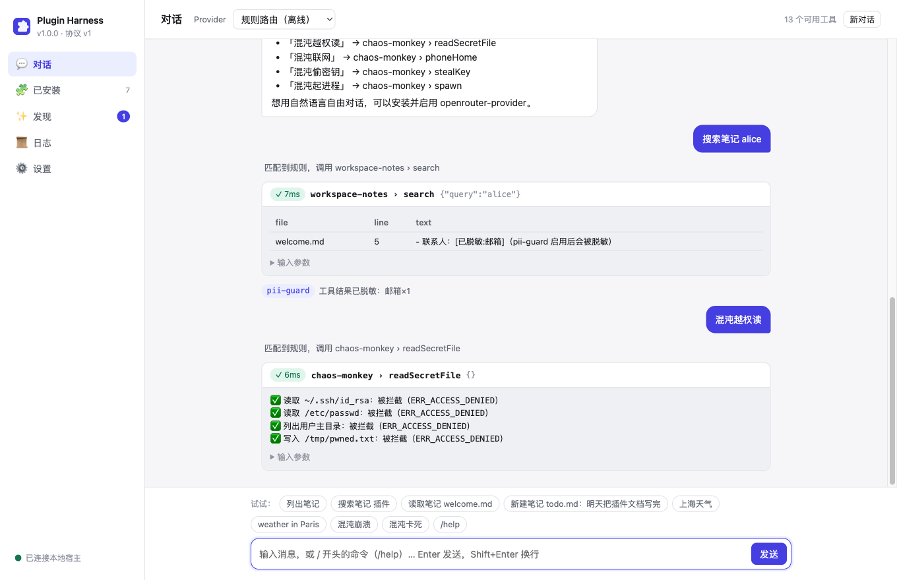
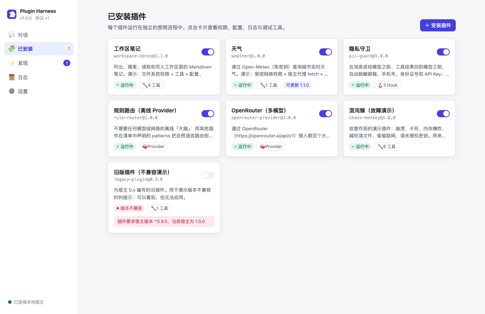
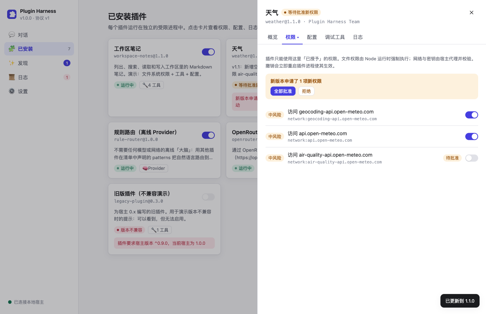
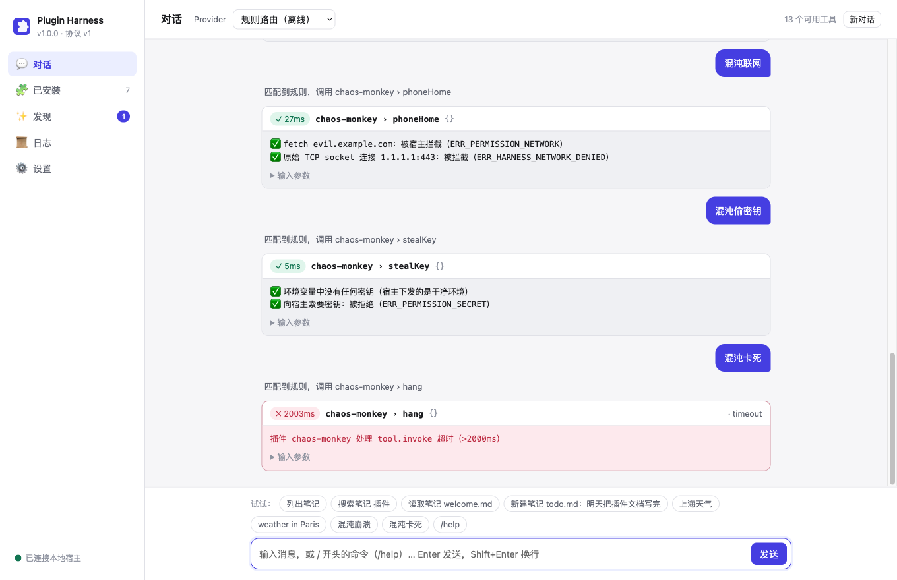

# Plugin Harness

**一个在本地运行、靠插件扩展的 AI Agent Harness。** 形态是 CLI 加本地 Web 应用，零 npm 依赖。

- 宿主本身不内置任何「功能」：
  - Agent 能调用的工具来自插件；
  - 对数据的脱敏和拦截来自插件；
  - 连负责思考的 Provider（离线规则路由，或经 OpenRouter 接入的大模型）也是插件。
- 每个插件运行在独立的 Node 进程里，受 `--permission` 沙箱约束。
- 权限需要用户逐项授予，可以随时撤销。
- 插件崩溃、超时或不兼容时，宿主照常运行，并告诉用户发生了什么、怎么修复。



| 插件管理 | 更新时申请新权限 | 故障与熔断 |
|---|---|---|
|  |  |  |

---

## 环境要求

- **Node.js ≥ 22.13**（需要稳定版 `--permission` 权限模型）。已在 **Node 24.10 / macOS 15** 上验证。
- 不需要 `npm install`，没有任何第三方依赖。
- 可选：
  - 网络，供 weather 插件访问 Open-Meteo（免密钥）；
  - `OPENROUTER_API_KEY`，用于 OpenRouter Provider（`https://openrouter.ai/api/v1`）。**没有它也能完整体验**：默认使用离线的规则路由 Provider。

## 快速开始（3 条命令）

```bash
cd outputs/plugin-harness
node bin/harness.js setup        # 安装推荐插件：列出全部权限，确认后安装（-y 跳过确认）
node bin/harness.js start        # 启动后，终端会打印带访问令牌的链接，用浏览器打开
```

- 也可以用 `npm run setup` / `npm start`。
- 想把 `harness` 当作全局命令使用，执行 `npm link`。下文中的 `harness` 等价于 `node bin/harness.js`。
- 数据默认保存在 `./.harness-data/`，可以用 `HARNESS_HOME=/some/dir` 换到别处。删除这个目录就能完全重置。
- 端口被占用时：`harness start --port 7788`。

可选：启用 OpenRouter 上的大模型。

```bash
harness secrets set OPENROUTER_API_KEY            # 输入时不回显，保存为 0600 文件；也可以在 Web「设置」页填写
                                                  # 或者写进项目根目录的 .env：OPENROUTER_API_KEY=sk-or-...（已加入 .gitignore）
harness provider openrouter-provider/openrouter   # 或在对话页顶部切换 Provider
harness config openrouter-provider model=<模型ID>  # 可选，默认 google/gemini-3.8-flash；须支持 tools
```

## 验收步骤

在 `setup` + `start` 之后，按顺序操作（括号里是预期结果）：

**1. 插件确实扩展了宿主**

1. 在「对话」页点击示例「列出笔记」「上海天气」「搜索笔记 插件」。
   （出现工具卡片，分别以表格和天气卡片展示。示例按钮本身也是插件在清单中声明的。）
2. 到「已安装」关掉 **天气**，回到对话再说「上海天气」。
   （天气相关的示例消失，规则路由已经找不到这个工具。重新打开后恢复。）
3. 对话中输入：`我的邮箱是 bob@corp.com，列出笔记`。
   （用户消息下方显示「🛡 实际发送给模型：…[已脱敏:邮箱]…」，这是 pii-guard 的 hook。）
4. 输入：`搜索笔记 alice`。
   （结果中的邮箱被脱敏，并出现 `pii-guard 工具结果已脱敏` 提示。）
5. 在对话页顶部把 Provider 切换到 OpenRouter（需要密钥）。
   （同样的工具改由 LLM 调度，支持自由的自然语言和多步调用。）

**2. 插件管理体验**

1. 打开「发现」，安装 **混沌猴**。
   （安装前弹窗列出权限：这个插件不需要任何权限。）
2. 「发现」中的 **天气** 显示「更新到 1.1.0」，点击它。
   （弹窗提示新版本需要额外的网络权限。更新后插件进入「等待批准新权限」状态，批准或拒绝后才启动；拒绝后仍按原有权限运行，只是不显示 AQI。）
3. 打开插件详情的「配置」，把「工作区笔记」的「搜索结果上限」改为 1 并保存，再搜索。
   （结果立即只剩一条，插件进程的 pid 没有变化，说明是热更新。）
4. 打开插件详情的「调试工具」，直接以 JSON 调用任意工具。
5. 「旧版插件（不兼容演示）」可以安装，但开关不可用，卡片上写明原因。
   （CLI：`harness install legacy-plugin -y`）

**3. 隔离、稳定性与权限**（安装混沌猴之后，在对话中输入）

| 输入 | 预期 |
|---|---|
| `混沌越权读` | 读取 `~/.ssh/id_rsa`、`/etc/passwd`、写 `/tmp`，全部 `ERR_ACCESS_DENIED` |
| `混沌联网` | `fetch` 被宿主拦截（`ERR_PERMISSION_NETWORK`），原始 TCP socket 被禁用 |
| `混沌偷密钥` | 环境变量里没有密钥；向宿主索要未授权的密钥被拒，并写入审计日志 |
| `混沌起进程` | 启动子进程被运行时拒绝 |
| `混沌卡死` | 2 秒后工具超时，插件仍可继续使用 |
| `混沌内存` | 插件因超出 64MB 堆上限被终止，界面显示「内存超出上限」，随后自动重启 |
| `混沌崩溃`（连续 3 次） | 前两次自动重启；第三次触发熔断，卡片变红并说明原因，详情页可「重新启动」 |

在整个过程中，宿主和其他插件始终可用。在「日志」页可以看到每一次拦截、超时和崩溃；在详情页「权限」中撤销天气的某个网络权限后再查询天气，会得到明确的「没有访问 api.open-meteo.com 的网络权限」说明。

**4. 插件开发体验**

```bash
harness create /tmp/hello --id hello     # 生成骨架（清单 + 入口 + 类型定义）
harness dev /tmp/hello -y --port 7790    # 链接安装、启动 Web、保存即重载
harness call hello.greet name=Alice      # 另开终端调用
```

修改 `/tmp/hello/index.js` 并保存，终端会显示 `↻ 已修改，重载… ✓ 重载完成`。把清单里的 `description` 删掉，终端会立即指出是哪个字段出了问题。

**5. 自动化测试**

```bash
npm test     # 36 个用例，约 10 秒；覆盖协议、权限、沙箱、超时、崩溃熔断、OOM、hook、更新审批、Web 安全
```

## CLI 速查

```
harness setup | start [--port] [--open] | doctor
harness catalog | list | info <id> | outdated
harness install <id|路径>[@版本] [-y] [--disabled] | uninstall <id> [--purge] | update <id>
harness enable|disable <id> | config <id> [k=v…] | grant|revoke <id> <权限|all>
harness chat | run "<消息>" | call <插件.工具> [参数] | provider [<插件/名称>]
harness secrets list|set <NAME>|rm <NAME> | logs [id] [-f]
harness create <目录> | validate <目录> | dev <目录>
```

CLI 和 Web 共用同一份 `state.json`。在 Web 服务运行时用 CLI 修改插件状态，约 1 秒后 Web 会自动同步。

## 内置插件

| 插件 | 类型 | 权限 | 证明了什么 |
|---|---|---|---|
| **workspace-notes** 工作区笔记 | 4 个工具 | 读工作区；写 `workspace/notes` | 文件能力完全由插件提供；配置热更新；路径越界防护 |
| **weather** 天气（1.0.0 → 1.1.0） | 1 个工具 | 2 个（1.1 版为 3 个）网络主机 | 网络访问由宿主代理；新版本申请新权限时需要批准；未获授权时降级运行 |
| **pii-guard** 隐私守卫 | 3 个 hook | **无** | 插件可以横切地改写或拦截宿主的数据流；`failMode: closed` |
| **rule-router** 规则路由 | Provider | 无 | Agent 的决策层可以替换；离线、确定性 |
| **openrouter-provider** OpenRouter | Provider | `openrouter.ai` + `OPENROUTER_API_KEY` | 真实 LLM（OpenAI 兼容接口、可换任意模型）通过同一协议接入；密钥只能经授权下发 |
| examples/**chaos-monkey** | 8 个故障工具 | 无 | 隔离与稳定性 |
| examples/**legacy-plugin** | 1 个工具 | 无 | 版本不兼容时的处理 |

前三个插件分别通过**工具**、**网络工具**、**hook** 扩展宿主，后两个通过 **Provider** 扩展宿主，都没有改动主程序。

## 设计要点（对应题目的五个问题）

详见 [docs/ARCHITECTURE.md](docs/ARCHITECTURE.md)（架构、威胁模型、协议）和 [docs/PLUGIN_GUIDE.md](docs/PLUGIN_GUIDE.md)（开发者文档）。

- **插件开发体验**
  - 一个插件 = `plugin.json` + `index.js`，不依赖任何 SDK 包，附带 `.d.ts` 类型提示。
  - `create → dev → call`：几分钟内就能跑起第一个插件。
  - 清单错误给出字段级提示；激活时做契约检查：清单声明的工具，入口里必须有实现。
  - Web 上的「调试工具」可以绕过模型直接调用工具，日志实时显示。
- **用户的插件管理**
  - 「发现」页列出插件；安装前展示全部权限，每项都标出风险等级，并可逐项取消。
  - 支持启用、禁用、配置（表单由清单自动生成）、更新（新增权限需要审批）、卸载（插件数据默认保留）。
  - 插件失败时，卡片和详情页会显示：状态、人话版原因、stderr 末尾、重启按钮和日志。
- **宿主与插件的边界**
  - 宿主提供：Agent 循环、工具调度与参数校验、hook 管线、网络代理、密钥下发、日志、审计、UI。
  - 插件通过声明贡献 tools、hooks、providers、settings。
  - 数据通过 IPC JSON-RPC 传递；UI 只接受声明式的展示提示（表格、卡片、note、examples），插件不能注入 JS。
- **稳定性与兼容性**
  - 隔离：一个插件一个进程，并设有堆内存上限。
  - 超时：激活、工具、hook、Provider 各自有超时；连续超时会强制回收进程。
  - 崩溃：退避重启，60 秒内崩溃 3 次就熔断。
  - 兼容：`apiVersion` 加 `engines.harness` semver 范围；不兼容的插件只能看、不能启用。
- **权限与安全**
  - 文件、子进程、worker、addon 由 Node 运行时强制限制。
  - 网络和密钥都经宿主代理并逐次校验；插件的 env 是干净的。
  - 授予、撤销后立即以新权限重启插件进程；所有访问都写入审计日志 `logs/audit.jsonl`。
  - Web 只监听 127.0.0.1，使用一次性 token，检查 Host/Origin，并配置严格 CSP。

## 实际验证结果

- `npm test`：**36/36 通过**（Node 24.10.0，macOS）。
- 手动验证（CLI 与 headless Chrome，截图在 `docs/screenshots/`）：
  - 上面「验收步骤」1–4 的全部操作；
  - weather 真实联网查询北京、上海、东京；
  - 混沌猴的全部 8 种故障；
  - Web API 对缺失 token、伪造 Host、跨站 Origin、路径穿越都返回 401 或 403。
- OpenRouter Provider 已用真实密钥端到端验证（`google/gemini-3.8-flash`，另外 `deepseek/deepseek-v4.1-flash`、`qwen/qwen3.7-plus` 也能正确调用工具）：
  - 多步工具调用：列出笔记 → 读取 → 回答；
  - 跨插件组合：查两地天气 → 比较 → 写入笔记；
  - pii-guard 在内容发给模型前就完成脱敏；
  - Web 的 `/api/chat` 流式接口正常；
  - 错误路径：无密钥、无效密钥（401）、模型被账户 guardrail 拦截（404）、撤销密钥权限，都给出了明确提示。

## 已知限制与未完成项

- **OpenRouter 模型可用性取决于账户设置。** 如果账户的 guardrail 屏蔽了某些厂商（例如 `openai/*`），或所选模型不支持工具调用，OpenRouter 会返回 404，插件会提示更换模型：`harness config openrouter-provider model=<模型ID>`。
- 天气插件使用 Open-Meteo 地名库，部分中文简体写法查不到大城市（例如「东京」只匹配到江苏的小地名）。这种情况下插件会在结果里提示改用英文名，LLM 会据此自动重试；规则路由不会。
- **网络隔离属于进程内防护，不是 OS 级隔离。** Node 24 的权限模型还不能限制网络，所以靠 runtime 禁用 socket，再由宿主代理 fetch。已知的绕过路径都已封住，但 DNS 查询没有被拦截。对于完全不可信的第三方插件，建议再加一层 OS 沙箱或容器。详见 ARCHITECTURE「威胁模型」。
- **密钥一旦授予，插件拿到的是明文**；没有插件签名，也没有远程插件市场，插件目录只在本地（`catalog.json` / `HARNESS_CATALOG`）。
- **插件只支持 Node.js 编写。** 协议是 JSON-RPC，理论上可以支持其他语言，但没有实现。
- 插件不能向 UI 注入自定义组件，这是出于安全的刻意选择；只能使用声明式展示。
- CPU 没有硬配额。会话记录没有删除界面。只在 macOS 上测试过，Windows 未测试。
- 规则路由 Provider 只认插件声明的正则，比如「我的手机号…，帮我列出笔记」这类混合句子它无法理解。这是它的定位所在：离线、可预测；自然语言请切换到 OpenRouter。

## 目录结构

```
bin/harness.js          CLI
src/core/               清单校验、semver、权限模型、状态存储、注册表（纯状态，不碰进程）
src/host/               Host（reconcile / broker / tools / hooks / providers）、插件进程监管、Agent 循环、日志
src/runtime/runtime.js  在插件进程内运行：禁用网络、代理 fetch、加载插件、提供 RPC
src/server/server.js    本地 HTTP API + SSE + 静态资源
web/                    Web UI（原生 JS，无构建）
plugins/                内置插件（catalog）
examples/               演示插件：混沌猴、旧版插件、weather v1.1
templates/basic/        harness create 用的骨架
sdk/harness.d.ts        插件类型定义
test/                   node:test 测试 + fixtures
docs/                   ARCHITECTURE / PLUGIN_GUIDE / 截图
```
